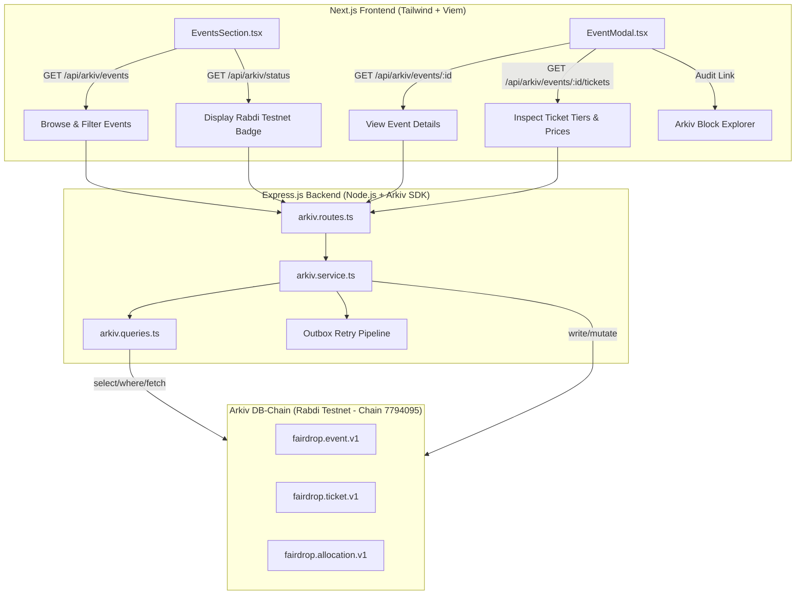

# How FairDrop Uses Arkiv: Technical Implementation Guide

This document describes the actual implemented integration of **Arkiv DB-Chain** in FairDrop across frontend components, backend endpoints, and data lifecycle management.

---

## 1. Feature Map: Where Arkiv Is Used

---

## 2. Implemented Features & Entity Interactions

### 2.1 Event Discovery (`EventsSection.tsx`)
- **Reads**: `fairdrop.event.v1`
- **User Experience**:
  - The discovery page dynamically queries `/api/arkiv/events`.
  - Attendees can filter by category (`All`, `Conference`, `Hackathon`, `Festival`, `Music`) and search by city/title.
  - A live network badge displays connection to `Rabdi Testnet • Chain ID 7794095`, current block height, and indexed entity counts.
- **Fields Filtered**: `category`, `city`, `eventStatus`.

### 2.2 Event Details & Ticket Selection (`EventModal.tsx`)
- **Reads**: `fairdrop.event.v1` and `fairdrop.ticket.v1`
- **User Experience**:
  - Displays event description, venue, dates, and live remaining ticket availability (`availableTicketCount` of `totalTicketSupply`).
  - Lists verified ticket tiers with pricing in USDC.
  - Displays the cryptographic Arkiv entity key (e.g., `0xarkiv_eth_mumbai_2026`).
  - Provides a direct link: **"Audit Event Entity on Arkiv Explorer"** pointing to `https://rabdi.explorer.arkiv.network`.

### 2.3 Ticket Claim & Allocation Recording (`arkiv.service.ts`)
- **Writes**: `fairdrop.allocation.v1` and updates `fairdrop.event.v1`
- **Trigger**: Upon successful attendee World ID proof verification and Arc USDC payment confirmation.
- **Backend Operation**:
  1. Calls `arkivService.recordAllocation(...)`.
  2. Creates a typed `fairdrop.allocation.v1` receipt with:
     - `allocationId`: Globally unique receipt UUID.
     - `eventId`: Target event ID.
     - `ticketId`: Claimed ticket tier.
     - `buyerWallet`: Attendee's EVM wallet address.
     - `paymentReference`: Arc transaction hash.
     - `allocationStatus`: `"confirmed"`.
  3. Mutates the parent `fairdrop.event.v1` entity to decrement `availableTicketCount`.

### 2.4 Event Creation (Organizer Flow)
- **Writes**: `fairdrop.event.v1` and associated `fairdrop.ticket.v1` records.
- **Endpoint**: `POST /api/arkiv/events`
- **Ownership**: Written with the organizer's authenticated address as `organizerWallet`.

---

## 3. Entity Ownership and Editing Rights

| Entity | Owner Field | Who Can Edit? | Mutation Operations |
| :--- | :--- | :--- | :--- |
| `fairdrop.event.v1` | `organizerWallet` | Event Organizer / Authorized Signer | Decrement inventory, update venue, change status to `sold_out` or `cancelled`. |
| `fairdrop.ticket.v1` | `sellerOrOrganizerWallet` | Ticket Seller / Organizer | Update tier price, mark as `claimed` or `available`. |
| `fairdrop.allocation.v1` | Escrow / `buyerWallet` | Immutable Public Receipt | Read-only; status update (`revoked` / `refunded`) restricted to organizer multisig. |

---

## 4. Entity Lifecycle & Expiration (TTL)

- **Configured TTL**: **90 Days** from creation.
- **Why 90 Days?**
  - Event campaigns typically run 30–60 days before the event date, followed by on-site verification and a post-event settlement window.
  - After 90 days, ticket listings are naturally pruned by the Arkiv network, preventing stale listings from cluttering public queries while optimizing storage costs.

---

## 5. How Arkiv Changes the Attendee Experience

1. **Proof of Genuine Inventory**: Attendees see the actual on-chain inventory counter rather than an opaque "Few tickets left!" sales pressure tactic.
2. **Auditable Web3 Receipts**: Claimants can verify their ticket allocation on the Arkiv explorer using their connected wallet address.
3. **Decentralized Reliability**: Event discovery remains functional even during private database maintenance, as public data is served directly from the Rabdi DB-Chain.
