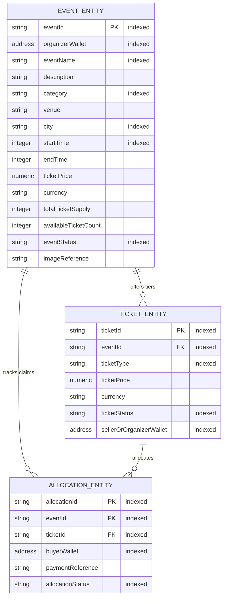

# FairDrop Arkiv Entity Schemas

FairDrop utilizes **Arkiv DB-Chain** (Rabdi Testnet, Chain ID `7794095`) as an open, queryable Web3 data layer for event listings, ticket inventory, and public allocation receipts.

---

## 1. Entity Overview & Architecture

FairDrop defines three core typed schemas using the official `@arkiv-network/sdk`:

| Schema Name | Version | Entity Type | Primary Key / Lookup | Owner Wallet Field |
| :--- | :--- | :--- | :--- | :--- |
| `fairdrop.event.v1` | `1.0.0` | Event Listing | `eventId` | `organizerWallet` (`address`) |
| `fairdrop.ticket.v1` | `1.0.0` | Ticket Tier Listing | `ticketId`, `eventId` | `sellerOrOrganizerWallet` (`address`) |
| `fairdrop.allocation.v1` | `1.0.0` | Ticket Allocation Receipt | `allocationId`, `ticketId` | `buyerWallet` (`address`) / Escrow |



---

## 2. Detailed Entity Definitions

### 2.1 Event Listing Entity (`fairdrop.event.v1`)

Represents the public canonical event listing stored on Arkiv. Organizers publish events here so that third-party indexers, frontends, and attendees can discover and verify events without proprietary API keys.

| Field Name | Type | Indexed | Description |
| :--- | :--- | :--- | :--- |
| `eventId` | `string` | **Yes** | Unique event identifier (e.g., `eth-mumbai-2026`). Primary reference across FairDrop. |
| `organizerWallet` | `address` | **Yes** | EVM address of the event organizer holding administrative ownership. |
| `eventName` | `string` | **Yes** | Public human-readable event title. |
| `description` | `string` | No | Full markdown or text event description. |
| `category` | `string` | **Yes** | Filtering category (e.g., `Conference`, `Hackathon`, `Festival`, `Music`). |
| `venue` | `string` | No | Physical venue or virtual location link. |
| `city` | `string` | **Yes** | City/Metropolitan area for location-based queries (e.g., `Mumbai`, `Bengaluru`). |
| `startTime` | `integer` | **Yes** | Unix timestamp (seconds) when the event starts. |
| `endTime` | `integer` | No | Unix timestamp (seconds) when the event ends. |
| `ticketPrice` | `numeric` | No | Base ticket price in units of settlement currency. |
| `currency` | `string` | No | Settlement token identifier (e.g., `USDC`). |
| `totalTicketSupply` | `integer` | No | Initial total number of tickets created for the event. |
| `availableTicketCount` | `integer` | No | Current remaining ticket count available for reservation. |
| `eventStatus` | `string` | **Yes** | Current lifecycle status: `active`, `sold_out`, `cancelled`, or `completed`. |
| `imageReference` | `string` | No | IPFS CID or CDN URL for event cover art. |

### 2.2 Ticket Listing Entity (`fairdrop.ticket.v1`)

Defines specific ticket tiers or individual ticket categories available for a given event.

| Field Name | Type | Indexed | Description |
| :--- | :--- | :--- | :--- |
| `ticketId` | `string` | **Yes** | Unique identifier for the ticket tier (e.g., `tkt-mumbai-vip-001`). |
| `eventId` | `string` | **Yes** | Relational foreign key linking to the parent `fairdrop.event.v1` entity. |
| `ticketType` | `string` | **Yes** | Ticket classification: `General Admission`, `VIP`, `Student`, `Speaker`. |
| `ticketPrice` | `numeric` | No | Price for this specific ticket tier. |
| `currency` | `string` | No | Payment currency (e.g., `USDC`). |
| `ticketStatus` | `string` | **Yes** | Status: `available`, `reserved`, `claimed`, or `expired`. |
| `sellerOrOrganizerWallet` | `address` | **Yes** | EVM wallet address of the ticket issuer or authorized seller. |

### 2.3 Allocation Entity (`fairdrop.allocation.v1`)

A pseudonymous public receipt published to Arkiv once a user has successfully verified their World ID proof of humanity, secured an allocation, and settled payment via Arc USDC.

| Field Name | Type | Indexed | Description |
| :--- | :--- | :--- | :--- |
| `allocationId` | `string` | **Yes** | Globally unique receipt ID (e.g., `alloc-92f7...`). |
| `eventId` | `string` | **Yes** | Relational foreign key linking to `fairdrop.event.v1`. |
| `ticketId` | `string` | **Yes** | Relational foreign key linking to `fairdrop.ticket.v1`. |
| `buyerWallet` | `address` | **Yes** | EVM address of the attendee who claimed the ticket. |
| `paymentReference` | `string` | No | Arc L1 transaction hash or payment receipt ID (e.g., `0xabc...`). |
| `allocationStatus` | `string` | **Yes** | State: `confirmed`, `pending`, `refunded`, `revoked`. |

> [!IMPORTANT]
> **Zero Personal Data on Arkiv**: FairDrop never writes attendee names, email addresses, phone numbers, or raw World ID proofs / nullifier secrets to Arkiv. Only pseudonymous EVM wallet addresses and cryptographic payment references are committed on-chain.

---

## 3. Querying & Indexing Strategy

All fields marked **Indexed** are registered as queryable columns in the Arkiv schema definition.

### Common Queries Executed by FairDrop Frontend & Backend

1. **Category Filtering**:
   ```typescript
   client.select().from(EventEntitySchema).where(eq("category", "Hackathon")).fetch();
   ```
2. **City Filtering**:
   ```typescript
   client.select().from(EventEntitySchema).where(eq("city", "Mumbai")).fetch();
   ```
3. **Compound Status & Category**:
   ```typescript
   client.select()
     .from(EventEntitySchema)
     .where(eq("eventStatus", "active"))
     .where(eq("category", "Conference"))
     .fetch();
   ```
4. **Ticket Tier Lookup by Event**:
   ```typescript
   client.select()
     .from(TicketEntitySchema)
     .where(eq("eventId", "eth-mumbai-2026"))
     .fetch();
   ```
5. **Attendee Claims by Wallet**:
   ```typescript
   client.select()
     .from(AllocationEntitySchema)
     .where(eq("buyerWallet", addr(attendeeWallet)))
     .fetch();
   ```

---

## 4. Ownership, Authorization & Mutation Rules

| Entity Type | Owner | Authorization Rule | Update Allowed |
| :--- | :--- | :--- | :--- |
| `fairdrop.event.v1` | `organizerWallet` | Only the organizer's authenticated key or FairDrop's designated organizer gateway signer can sign update transactions. | Yes (Status changes, availability updates, metadata edits). |
| `fairdrop.ticket.v1` | `sellerOrOrganizerWallet` | Initialized during event creation; status transitions managed by organizer signer. | Yes (Status: `available` -> `claimed`). |
| `fairdrop.allocation.v1` | Escrow / Buyer | Generated upon successful World ID validation + Arc settlement. Immutable receipt once confirmed. | Revocation / refund only by organizer multisig. |

---

## 5. Expiration & TTL (Time-To-Live)

- **Default TTL**: Set to **90 days** (`defaultTtlDays = 90`) from creation.
- **Rationale**:
  - Event discovery and ticket purchasing typically happen 30–60 days before an event date.
  - The 90-day window ensures ticket data remains fully available and indexable through the event's completion and post-event attendee verification period.
  - Expired entities naturally garbage collect on Arkiv, preventing permanent chain bloat while keeping operational gas costs minimal.

---

## 6. Schema Versioning

- Each schema definition includes an explicit `schemaVersion: "1.0.0"` in its configuration payload.
- Namespaces are scoped with the semantic version suffix `fairdrop.<entity>.v1`.
- Future schema migrations will introduce `.v2` namespaces, allowing backward-compatible parallel queries during protocol upgrades.
